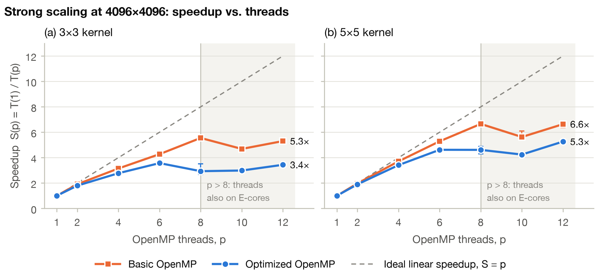
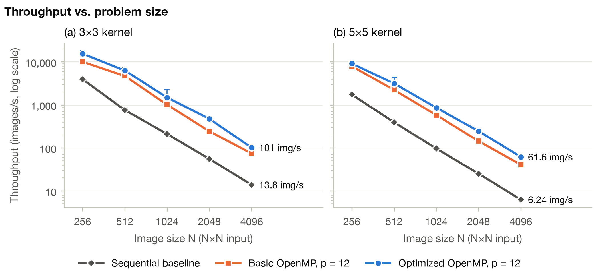
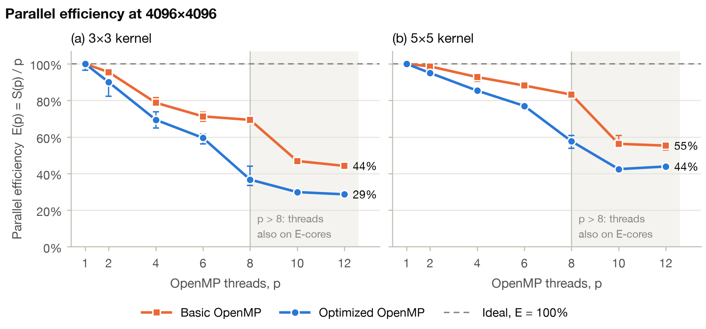

# Parallel 2D Convolution

A parallel implementation of single-channel 2-D convolution (valid cross-correlation, stride 1, no padding,
`double` precision) in C++17 with OpenMP. It has a sequential baseline, two parallel versions and a
correctness-gated benchmark suite that measures them on real photos from the DIV2K dataset and reproduces every
chart below with one command.

| Implementation | Strategy |
| --- | --- |
| `serial` | sequential baseline (four nested loops) |
| `basic` | `#pragma omp parallel for` over output rows |
| `optimized` | `collapse(2)` over all output pixels, `schedule(static)`, raw-pointer inner loops |

An N×N image and a K×K kernel give an (N−K+1)×(N−K+1) output; the kernel is not flipped, matching PyTorch `conv2d`.

---

## 1. Prerequisites & Environment
- **Target OS / Architecture**: macOS on Apple silicon (ARM64), where the results below were measured. Linux
  with GCC also works (tested: GCC 13, x86_64).
- **Compiler / Toolchain**: CMake ≥ 3.20; a C++17 compiler with OpenMP (Apple clang + Homebrew `libomp` on
  macOS, GCC on Linux); Python ≥ 3.9.
- **Dependencies** (`requirements.txt`): `torch` and `numpy` (independent reference for the correctness tests),
  `pillow` (decodes the test and benchmark photos), `matplotlib` (charts).

```bash
# macOS only: compiler tools, CMake and the OpenMP runtime
xcode-select --install
brew install cmake libomp

# Python packages in a virtual environment (CMake uses it when it is active)
python3 -m venv .venv
source .venv/bin/activate
pip install -r requirements.txt
```

---

## 2. Build & Correctness Test
To compile the binaries and verify algorithmic correctness:

```bash
# Build the project (Release) into build/
cmake -S . -B build -DCMAKE_BUILD_TYPE=Release
cmake --build build --parallel

# Run all 23 unit / correctness tests
ctest --test-dir build --output-on-failure
```

The 21 correctness tests compare the three implementations with each other and with PyTorch
(`torch.nn.functional.conv2d`, float64, tolerance 1e-10). They cover:
- hand-computed cases, and identity, zero and all-ones kernels;
- random inputs with fixed seeds (rectangular shapes, kernels 1×1 to 7×7, 1/2/4/8 threads);
- 100 CIFAR-10 test images, 100 CIFAR-100 test images and 20 ImageNet sample images;
- invalid-input checks, and AddressSanitizer and UndefinedBehaviorSanitizer builds.

The other two tests check the benchmark's image reader and Gaussian kernels, and run the whole benchmark
pipeline on a tiny matrix.

---

## 3. Dataset Preparation
*(Note: As per assignment guidelines, raw datasets are not stored in this repository.)*

**Benchmark dataset: DIV2K.** Every performance number comes from real photos in the DIV2K validation set
(100 high-resolution photos from the NTIRE 2017 challenge; for academic research use).
`benchmark/prepare_dataset.py` handles it, and the first `./benchmark/run_benchmark.sh` runs it automatically:
1. It downloads <https://data.vision.ee.ethz.ch/cvl/DIV2K/DIV2K_valid_HR.zip> (449 MB) into `./data/div2k/`
   and checks its SHA-256 (`20dd31fd…900fc`).
2. It takes the first 10 photos, `0801.png` to `0810.png`, which are about 2040×1356 pixels.
3. It converts each photo to 8-bit grayscale (ITU-R BT.601 luma), crops the central square and resizes it to
   N×N with a Lanczos filter, for N = 256 to 4096. The 2048×2048 and 4096×4096 inputs are therefore upscaled.
4. It saves the results as `data/div2k/npy/N/<id>.npy` (uint8) and records checksums in
   `data/div2k/manifest.json`. The timing harness divides by 255 to get `double` pixels in [0, 1].

The benchmark kernels are normalised K×K Gaussian blurs, with σ = 0.3·((K−1)/2 − 1) + 0.8 (OpenCV's default
for `getGaussianKernel`).

**Correctness-test datasets.** These download into `./data/` on the first test run and are checked
(MD5 checksums for CIFAR, image validation for ImageNet). Images become grayscale as
(0.299R + 0.587G + 0.114B)/255. The test kernels are a 3×3 Laplacian [[−1,−1,−1],[−1,8,−1],[−1,−1,−1]] and
seeded random 5×5 and 7×7 kernels.

| Dataset | Used as | Source |
| --- | --- | --- |
| CIFAR-10 test batch | first 10 / 100 images, grayscale 32×32 | <https://www.cs.toronto.edu/~kriz/cifar.html> (fetched from the mirror <https://github.com/0Colin/cifar-10-batches-py>) |
| CIFAR-100 test set | first 100 images, grayscale 32×32 | <https://www.cs.toronto.edu/~kriz/cifar-100-python.tar.gz> |
| ImageNet sample images | 20 images, grayscale, at most 192 px | <https://github.com/EliSchwartz/imagenet-sample-images> (commit `bc69043`) |

To keep datasets somewhere else, set `CONV_DATA_ROOT=/path/to/data` before running CMake and the benchmark.

---

## 4. How to Reproduce Performance Benchmarks
To run the full suite of experiments and reproduce all results:

```bash
# 1. Build (Release), run the correctness gate, prepare DIV2K, run every experiment
#    (writes results/benchmark_data.csv and the other CSVs), then draw the charts
./benchmark/run_benchmark.sh

# 2. Re-draw the charts from the CSVs (saves PNGs and summary.md to results/)
python3 benchmark/plot.py
```

The full run takes about 3 minutes on an M4 Pro. The first run also downloads and converts DIV2K, which adds a
few minutes depending on the connection. Plug the machine in and close busy apps first. Nothing is timed unless
all 21 correctness tests pass. Any option of `benchmark/run_experiments.py` can be appended, for example
`./benchmark/run_benchmark.sh --threads 1,2,4,8`.

| Parameter | Default |
| --- | --- |
| Input data | 10 DIV2K photos per configuration, grayscale, resized to N×N; each timed call uses the next photo in turn |
| Image sizes N | 256, 512, 1024, 2048, 4096 |
| Kernel sizes K | 3, 5, 7, 11 (Gaussian blur) |
| OpenMP threads p | 1, 2, then every even count up to the logical core count (1, 2, 4, 6, 8, 10, 12 on an M4 Pro) |
| Repetitions | 3 untimed warm-ups + 10 timed calls per configuration; each configuration in a fresh process; medians reported |
| Timing scope | one convolution call, including output allocation (`std::chrono::steady_clock`); images are loaded before timing |
| End-to-end pass | whole-process time (launch, loading one photo, OpenMP start-up, one cold call) for K = 3, 5; 5 shuffled repeats |

| Output in `results/` | Content |
| --- | --- |
| `benchmark_data.csv` | per configuration: median, IQR, mean, std, min, max, speedup, speedup over serial, efficiency, GFLOP/s, images/s |
| `samples.csv` | every timed call, with the photo it used |
| `end_to_end.csv` | whole-process and cold-call times |
| `environment.json`, `run_info.json` | hardware, OS, compiler, OpenMP, source and dataset checksums, parameters |
| `*.png`, `summary.md` | charts and the tables behind them |

### CLI Interface & Manual Execution
You can also run individual benchmarks via the CLI:
```bash
# Prepare the photos once (or let run_benchmark.sh do it)
python3 benchmark/prepare_dataset.py

# Time one configuration: IMPLEMENTATION(serial|basic|optimized) K THREADS WARMUPS RUNS IMAGE.npy...
./build/convolution_benchmark optimized 5 8 3 10 data/div2k/npy/4096/08*.npy   # prints 10 runtimes in ms
./build/convolution_benchmark --metadata          # compiler, build type, OpenMP version, input and kernel

# Convolve your own matrices: text files with a "rows cols" header, then row-major values
./build/conv_serial_cli    input.txt kernel.txt output.txt
./build/conv_omp_cli       input.txt kernel.txt output.txt 8   # basic OpenMP, 8 threads
./build/conv_optimized_cli input.txt kernel.txt output.txt 8   # optimized OpenMP, 8 threads
```

---

## 5. Performance Evaluation & Charts

### Experimental Setup
- **CPU**: Apple M4 Pro, 12 cores (8 performance + 4 efficiency, one thread per core), MacBook Pro (Mac16,8)
- **RAM**: 24 GB unified memory
- **OS**: macOS 15.6.1, on AC power
- **Compiler Flags**: Apple clang 16.0.0, `-O3 -DNDEBUG -Xpreprocessor -fopenmp`, LLVM libomp 23.1.1 (OpenMP 5.1)
- **Input**: 10 DIV2K photos per configuration with Gaussian kernels (section 3), measured on 2026-10-28

`results/environment.json` and `results/run_info.json` hold the full record, including dataset checksums.
Rerunning step 4 regenerates every file in `results/`. Throughput is images processed per second: 1000 divided
by the median time per image in ms. Speedup is S(p) = T(1)/T(p) of the same implementation (equal to the
throughput ratio), and efficiency is S(p)/p.

### Results & Scaling Analysis

#### 1. Strong Scaling (Speedup vs Threads)

- **Analysis**: Speedup is close to linear up to 4–6 threads. The basic version peaks at p = 8, the number of
  performance cores: 5.5× for 3×3 and 6.7× for 5×5. It drops at p = 10, because the static schedule gives the
  slower efficiency cores an equal share of the rows.
- **Amdahl's law**: the optimized version gains little beyond 6 threads. Fitting Amdahl's law to it (p ≤ 6) gives
  a serial part of about 5–7 ms per call at 4096×4096. That is consistent with each call allocating and
  zero-filling its 128 MiB output on one thread.
- **Absolute speed**: the optimized version's self-relative speedup is lower mainly because its 1-thread time is
  half the baseline's, so the same serial part weighs twice as much. Against the sequential baseline it is the
  fastest: 7.6× for 3×3 (p = 6) and 9.9× for 5×5 (p = 12) (`results/speedup_vs_baseline.png`).
- **Noise**: points at p ≥ 6 vary more between calls, as the IQR bars show. The optimized 3×3 dip at p = 8 comes
  from a burst of slow calls (6 of its 10).

#### 2. Throughput vs Problem Size

- **Analysis**: From 512×512 up, every version's throughput falls about 4× per doubling of N, because each
  image has 4× as many pixels (O(N²K²) work). At 4096×4096 with 12 threads, the optimized version processes
  101 images/s with the 3×3 kernel and 62 with 5×5, against 13.8 and 6.2 for the sequential baseline. Across
  sizes its throughput is 3.9–8.6× the baseline's for 3×3 and 5.2–9.9× for 5×5. The gain is smallest at
  256×256: the optimized version already handles about 15,000 images/s there (0.07 ms each), so thread
  start-up and synchronisation weigh more.

#### 3. Efficiency

- **Analysis**: At p = 8, efficiency is 69% (basic) and 37% (optimized) for 3×3, and 83% and 58% for 5×5. At
  p = 12, once the efficiency cores join, it is 29–55%.
- **Not bandwidth-bound**: the fastest 4096×4096 3×3 run needs only about 28 GB/s of input and output traffic,
  a tenth of the M4 Pro's 273 GB/s. Larger kernels do more arithmetic per pixel and scale better: 11×11 reaches
  8.5× (71%) at p = 12 and 16.1× over the baseline (`results/kernel_size.png`).

More charts in `results/`:
- `speedup_vs_baseline.png`: speedup over the sequential baseline.
- `kernel_size.png`: throughput and speedup vs kernel size.
- `gflops.png`: compute throughput in GFLOP/s; up to 58 GFLOP/s for 11×11.
- `speedup_vs_size.png`: speedup vs N.
- `end_to_end.png`: whole-process time breakdown. At 4096×4096, process start-up and image loading cut the
  optimized version's end-to-end gain to 2.8×, against 7.3× for the kernel alone (3×3, p = 12).
